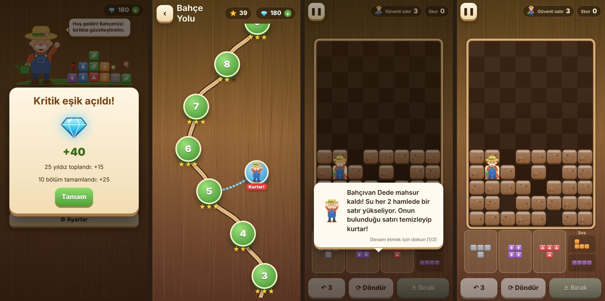
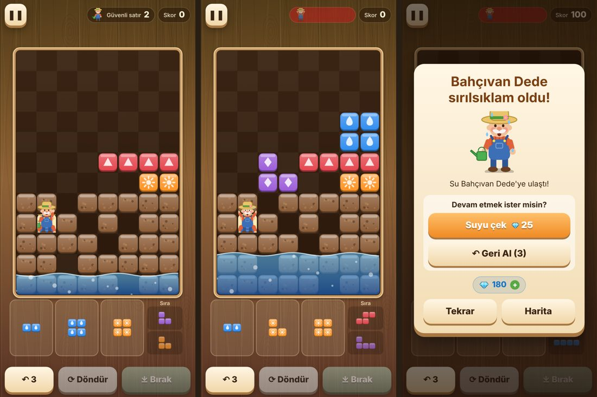
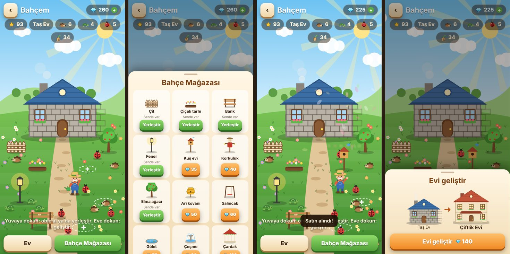
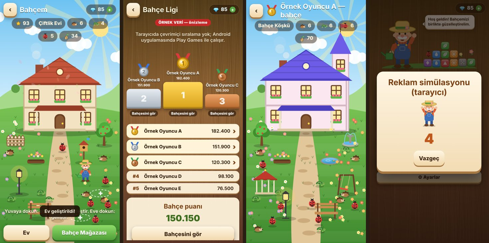
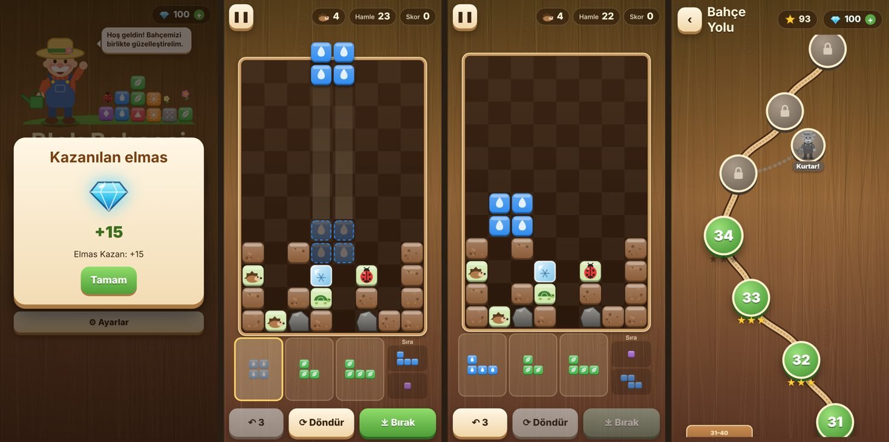
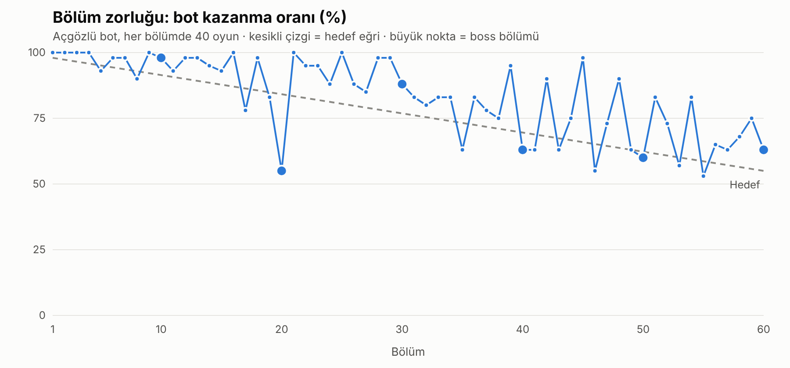

# Blok Bahçesi v0.2 — Güncelleme Raporu

## 1. Royal Match tarzı oyunların analizi

Bu bölüm türün genel kalıplarını özetler. Blok Bahçesi'nde hiçbir isim, karakter, görsel, müzik ya da bölüm birebir alınmadı; yalnızca türün oyun tasarımı fikirlerinden esinlenildi.

| Türdeki kalıp | Oyuncuya etkisi | Blok Bahçesi'ndeki karşılığı |
|---|---|---|
| **Karakteri kurtarma bölümleri** (ana karakter tehlikede; tehlike her hamlede yaklaşır) | Duygusal bağ, aciliyet ("onu kurtarmalıyım"), kısa ve gergin bir bulmaca | **Bahçıvanı Kurtar**: Bahçıvan Dede tahtada mahsur. Su her N hamlede bir satır yükseliyor. Onun satırını temizleyince kurtuluyor. Altındaki satırları temizlersen Dede suya doğru kayıyor, bu yüzden önce üstündeki "çatı"yı açmak gerekiyor. |
| Karakterin tepkileri (korku, ıslanma, sevinç) | Başarısızlık bile eğlenceli; tekrar deneme isteği | Dede su yaklaşınca **terleyip titriyor**. Kaybedince **sırılsıklam** oluyor, kurtarılınca **zıplayıp el sallıyor**. |
| Kurtarılan karakterin teşekkürü / ödül | Olumlu duygu + ilerleme | "Sağ ol evlat!" diyor ve **+30 elmas** veriyor. |
| Kaybedince devam teklifi (+5 hamle) | "Az kaldı" anında oyunu sürdürme | Elmasla **+5 hamle (30)**, **Suyu çek (25)**, **Ek geri alma (10)**. |
| Yıldız/para ile mekân dekorasyonu | Uzun vadeli hedef, sahiplenme | **Bahçem**: 5 seviyeli ev ve elmasla alınan 12 obje (bazıları yıldız eşiğiyle açılır). |
| Bölüm gruplarına adlar | Harita boyunca ilerleme hissi | 6 bölüm grubu: Bahar Bahçesi → Kış Serası. |
| Sıralamalar | Sosyal motivasyon | **Bahçe Ligi** (Google Play Games): ilk üç oyuncu altın, gümüş ve bronz madalya alır; bahçeleri ziyaret edilebilir. |
| Testere dişli zorluk (zor bölümden sonra rahat bölüm) | Bıkkınlığı önler | Kalibrasyon grafiğinde de görülüyor (bölüm 3). |

## 2. Senaryolar (görseller)

**Ana menü, kritik eşik ödülü, harita ve kurtarma bölümü girişi**

**Su yükseliyor → Dede tehlikede → kaybedince elmasla devam ("Suyu çek")**

**Bahçem: ev, mağaza, satın alma, ev geliştirme (Taş Ev → Çiftlik Evi)**

**Geliştirilmiş ev · Bahçe Ligi (madalyalar) · 1. oyuncunun bahçesini ziyaret · reklam izle**

> Sıralama ekranındaki isimler, tarayıcı önizlemesi için **açıkça "ÖRNEK VERİ" olarak etiketlenmiş** sahte verilerdir. Gerçek liste Android'de Play Games'ten gelir.

**Reklam ödülü · 34. bölüm (hayalet + ışın) · çift dokunuşla bırakma · 31–40 grubu ve kilitli kurtarma düğümü**

## 3. Kademeli zorluk (veriyle)

Bölümler bir **açgözlü bot** (`src/game/bot.ts`) ile kalibre edildi (`scripts/calibrate.ts`). Bot her bölümü 40 kez oynar ve hamle ihtiyacının dağılımını çıkarır. Hamle sınırı, botun hedef orana göre kazanacağı şekilde seçilir. Hedef oran 1. bölümde %98, 60. bölümde %55; boss bölümlerinde 5 puan daha düşük.

- Ham veri: `docs/difficulty.tsv`.
- İlk ölçümde eski 19. bölüm bot için çözülemez çıktı, 20. bölüm boss'unda da bot ancak %17 kazanıyordu. Haritalar düzeltildi (20. bölümün boss canı 16'dan 14'e indi).
- Hayvan ve tohum bölümleri eskiden 1–3 hamlede bitiyordu. Yeni bölümlerde en az 5–11 hamle gerekiyor.

| Kurtarma bölümü | Açıldığı yer | Su hızı | Bot kazanma |
|---|---|---|---|
| Su Baskını! | 5. bölümden sonra | 2 hamlede 1 satır | %100 |
| Bodrumda Mahsur | 15 | 2 | %85 |
| Sarmaşık Tuzağı (yabani ot çatısı) | 25 | 2 | %88 |
| Kaya Kuyusu | 35 | 2 | %83 |
| Buzlu Mahzen | 45 | 3 | %78 |
| Büyük Sel | 55 | 2 | %83 |

> Bot hamle planlamadığı için çok katmanlı çatılarda zorlanır; insan oyuncu için bu bölümler genelde botun gösterdiğinden kolaydır.

## 4. Elmas ekonomisi

| Kazanç | Elmas |
|---|---|
| Hoş geldin hediyesi | 25 |
| Yeni bölüm / ilk 3 yıldız | 2 / 3 |
| Boss (fırtına) ilk zafer | 20 |
| Bahçıvanı Kurtar | 30 |
| Kritik eşikler: 10, 25, 45, 70, 100, 130, 160 yıldız | 10 → 60 |
| Kritik eşikler: 10, 20, …, 60 bölüm | 25 → 50 |
| Reklam izle (günde 5) | 15 |

| Harcama | Elmas |
|---|---|
| Ek geri alma | 10 |
| +5 hamle | 30 |
| Suyu 2 satır çek | 25 |
| Bahçe objeleri | 15–120 |
| Ev geliştirme | 40 / 80 / 140 / 220 (5 / 20 / 45 / 80 yıldız şartıyla) |

## 5. Yayından önce sizin yapmanız gerekenler

1. **Google Play Games (kimlik + sıralama)**
   1. Play Console'da uygulamayı oluşturun (`com.blokbahcesi.app`).
   2. Play Games Services'i açın ve "Bahçe Ligi" adında bir sıralama oluşturun (puan biçimi: sayısal, büyük daha iyi).
   3. Android kimlik bilgisi ekleyin. Debug APK'nın SHA-1 parmak izi (depodaki `debug.keystore`):
      `09:5F:7C:9D:2F:23:53:B5:50:D1:33:74:D7:1D:8A:57:61:B0:0F:4D`
   4. GitHub → Settings → Secrets → Actions altına şunları ekleyin:
      - `PGS_APP_ID` (sayısal proje kimliği)
      - `PGS_LEADERBOARD_ID` (CgkI… ile başlayan sıralama kimliği)
   5. Test için kendi Google hesabınızı "test kullanıcısı" olarak ekleyin.
   6. Secrets tanımlı değilken uygulama çöker değil: sıralama ekranı "yapılandırılmamış" der ve kendi bahçe puanınızı gösterir.
2. **AdMob (reklam izle kazan)**
   - Şu an Google'ın **test** kimlikleri kullanılıyor; gerçek para kazandırmaz.
   - Yayında `ADMOB_APP_ID` ve `ADMOB_REWARDED_ID` secret'larını ekleyin.
   - Uygulamada rıza formu (UMP) çağrılıyor; AdMob panelinde GDPR mesajını oluşturun.
   - Play Console'da gizlilik politikası ve Veri güvenliği formu gerekir.
3. Gerçek cihazda kontrol edin: ses/müzik düzeyi, reklam akışı ve Play Games girişi. Bunları bu ortamda test edemedim; yalnızca tarayıcıda ve CI derlemesinde doğrulandı.
